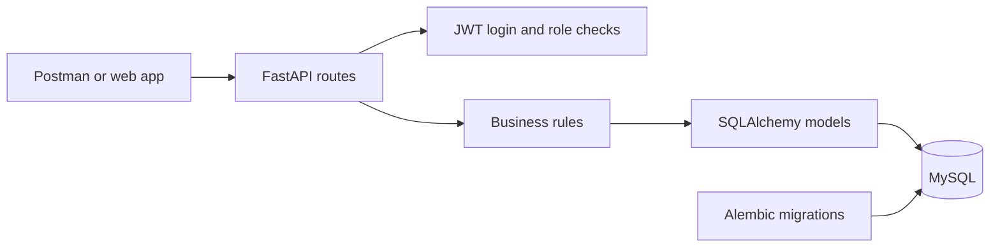
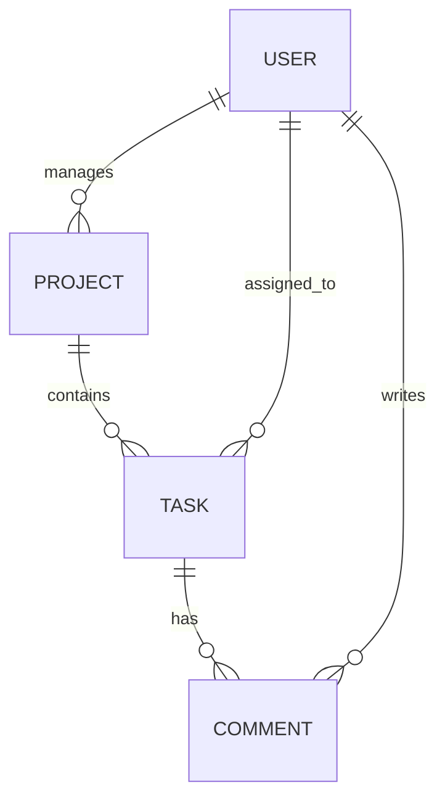

# Task Management API

A beginner-friendly REST API built with FastAPI, SQLAlchemy, Alembic, MySQL, JWT, Docker, and Pytest.

## 1. Business idea

This API helps a team organize work. A project manager creates a project, adds tasks, and assigns each task to a team member. The assigned member updates progress and the team can discuss work through comments.

## 2. Architecture



The client sends HTTP requests. FastAPI validates the request, checks the login token and permissions, applies the business rule, and uses SQLAlchemy to read or change MySQL. Alembic manages database structure changes.

## 3. Main request flow

1. Register a manager or member. Public registration cannot create an admin account.
2. Use a valid `@gmail.com` address for registration and login. Other email domains (such as `@example.com`) are rejected. Log in with email and password to receive a JWT access token.
3. Send that token as `Authorization: Bearer <token>` on protected requests.
4. A manager creates a project and then creates tasks inside it, assigning each task to a member.
5. Members see their own tasks at `/my/tasks`. Only the assigned member can change a task's status.
6. A member can add a comment to a task. Only its author or an admin can delete that comment.
7. Managers can edit and delete tasks only in projects they manage. Admins can manage any project and task.
8. Deleting a project deletes its tasks and their comments too.
9. Project lists and project summaries are available to signed-in users. Task lists and task details are scoped: members see only tasks assigned to them, and managers can access tasks only in projects they own.

## 4. Database relationships



- **User** has many managed projects, assigned tasks, and written comments.
- **Project** belongs to one manager and contains many tasks.
- **Task** belongs to one project and has one assigned user. Its status is `todo`, `in_progress`, `review`, or `done`. Its priority is `low`, `medium`, `high`, or `critical`.
- **Comment** belongs to one task and one author.
- Foreign keys connect these records. Project-to-task and task-to-comment deletes cascade, so no task/comment is left without its parent.

## 5. API endpoints

All responses are JSON. Protected endpoints need a bearer token.

| Method | Path | Purpose |
|---|---|---|
| POST | `/auth/register` | Register a member or project manager |
| POST | `/auth/login` | Get a JWT token (form fields: email and password) |
| POST | `/projects` | Manager/admin creates a project |
| GET | `/projects` | List projects with `skip` and `limit` pagination |
| GET | `/projects/{project_id}` | Project details and task counts by status |
| DELETE | `/projects/{project_id}` | Admin deletes a project and its child data |
| POST | `/projects/{project_id}/tasks` | Manager/admin creates and assigns a task |
| GET | `/projects/{project_id}/tasks` | List tasks; optional `status`, `priority`, `assignee_id` filters |
| GET | `/tasks/{task_id}` | Get task details |
| PATCH | `/tasks/{task_id}/status` | Assignee changes status to the next step |
| PUT | `/tasks/{task_id}` | Owning manager/admin changes task details |
| DELETE | `/tasks/{task_id}` | Owning manager/admin deletes a task |
| POST | `/tasks/{task_id}/comments` | Any signed-in user adds a comment |
| GET | `/tasks/{task_id}/comments` | List comments on a task |
| DELETE | `/comments/{comment_id}` | Comment author/admin deletes a comment |
| GET | `/my/tasks` | Member lists assigned tasks |
| GET | `/health` | Service health check |

## 6. Run locally

### Docker (recommended)

On Windows PowerShell, create `.env` from the example only if you do not already have one:

```powershell
if (-not (Test-Path .env)) { Copy-Item .env.example .env }
```

Open `.env` and set a private `SECRET_KEY`, `BOOTSTRAP_ADMIN_PASSWORD`, and MySQL passwords before starting the containers. For this local Compose setup, use simple letters and numbers in the MySQL passwords so they fit safely in the connection URL. The example passwords are for local learning only; do not use them on a public server.

Then start Docker Compose:

```powershell
docker compose up --build
```

The API is at <http://localhost:8000>; interactive docs are at <http://localhost:8000/docs>. The API container uses Python 3.11, waits for MySQL 8.0 to become healthy, runs Alembic migrations, creates the configured bootstrap admin if needed, and then starts FastAPI. Docker's MySQL is available on host port `3307`, which avoids clashing with a local MySQL server already using `3306`. Both ports are bound to `127.0.0.1`, so they are reachable only from this PC during local development.

To stop the containers while keeping the database data, press `Ctrl+C` and run:

```powershell
docker compose down
```

To view API logs in another terminal, run `docker compose logs -f api`.

If the Docker admin login password was changed in `.env` after the admin was first created, the existing database keeps its old password. Choose a new private `BOOTSTRAP_ADMIN_PASSWORD` in `.env`, then run these commands in a second PowerShell window from the project folder to apply it without deleting database data:

```powershell
docker compose up -d --force-recreate api
docker compose exec api python -m bootstrap --reset-password
```

Then log in at <http://localhost:8000/docs> using `BOOTSTRAP_ADMIN_EMAIL` and the new password. The reset option is explicit; normal container starts do not reset an existing admin password.

### Run directly on Windows with your local MySQL

Make sure MySQL is running and the `.env` file points to your local database. The database URL format is:

```text
mysql+pymysql://root:<URL-encoded-password>@127.0.0.1:3306/task_management
```

Encode special characters in the password for the URL. For example, `@` becomes `%40`. Keep `.env` private; it is ignored by Git and excluded from the project ZIP.

Open PowerShell in the project folder and run:

```powershell
py -m venv venv
.\venv\Scripts\Activate.ps1
python -m pip install -r requirements.txt
alembic upgrade head
```

To create an admin account for testing, set its credentials in this PowerShell window before starting the app. These values are only examples; choose your own local password:

```powershell
$env:BOOTSTRAP_ADMIN_EMAIL = "admin@gmail.com"
$env:BOOTSTRAP_ADMIN_PASSWORD = "Choose-A-Local-Password-123!"
python -m bootstrap
python -m uvicorn main:app --reload --port 8001
```

Open <http://127.0.0.1:8001/docs> and start with `GET /health`. Keep the terminal open while testing. If `.env` is removed, the app falls back to the local SQLite file `task_management.db`.

### Run tests

```bash
py -m venv venv
# Windows PowerShell: .\venv\Scripts\Activate.ps1
# macOS/Linux: source venv/bin/activate
python -m pip install -r requirements.txt
python -m pytest
```

Tests use SQLite in memory, so a local MySQL server is not needed to run them.

### Create a database migration

After changing a model, with the configured database available, run:

```bash
alembic revision --autogenerate -m "describe change"
alembic upgrade head
```

## 7. First users

Registration accepts `member` and `project_manager`. Admin creation is deliberately excluded from public registration so a visitor cannot grant themselves full access. Set `BOOTSTRAP_ADMIN_EMAIL` and `BOOTSTRAP_ADMIN_PASSWORD` in `.env`; the app creates that admin account at startup if it does not exist. In a real deployment, protect the environment file and use a strong unique password.

## 8. Example requests

Register:

```json
POST /auth/register
{
  "name": "Ravi Kumar",
  "email": "ravi@gmail.com",
  "password": "StrongPass123!",
  "role": "project_manager"
}
```

Login with form fields `email=ravi@gmail.com` and `password=StrongPass123!`; copy `access_token` from the response. Click **Authorize** in Swagger and paste the token for protected requests. Create a project with a bearer token:

```json
POST /projects
{
  "name": "Website Refresh",
  "description": "Update the public website"
}
```

Create task:

```json
POST /projects/1/tasks
{
  "assignee_id": 2,
  "title": "Build the landing page",
  "description": "Implement the approved design",
  "priority": "high",
  "due_date": "2026-11-10"
}
```

## 9. Folder guide

- `main.py`: starts the application and connects route modules.
- `models.py`: database tables and relationships.
- `schemas.py`: request and response shapes.
- `database.py`: SQLAlchemy database connection and base class.
- `dependencies.py`: database session and current-user lookup.
- `routers/`: HTTP endpoints, grouped by business area.
- `services/`: business rules and database operations used by routes.
- `utils/security.py`: password hashing and JWT handling.
- `middleware/`: request logging and shared error responses.
- `bootstrap.py`: creates the first admin from environment settings.
- `alembic/`: database migration setup and first migration.
- `tests/`: automated checks for status rules, permissions, and comments.
- `.dockerignore`: keeps local secrets, virtual environments, and test files out of the Docker build context.
- `postman/`: ready-to-import Postman collection for trying every API endpoint.
- `API_TEST_CASES.md`: beginner-friendly sample requests, role requirements, and expected results for every endpoint.
- `ROLE_BASED_API_CHECKLIST.md`: tick-box Swagger checklist with sample manager, member, and admin tests.

## 10. Notes

This is a review-ready assessment starter, not a deployed service. Add HTTPS, secret management, rate limiting, logging, and a production-grade MySQL backup plan before a public launch. Set `SECRET_KEY` to a long random value outside development.
